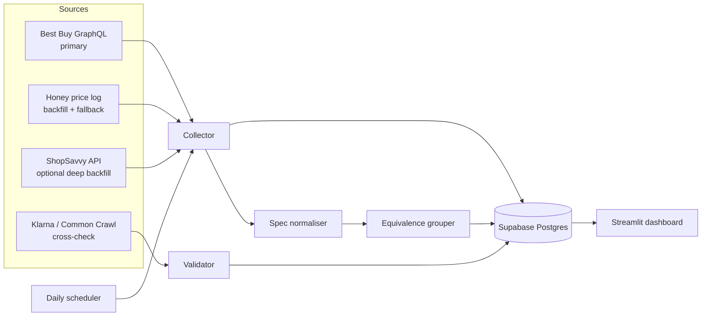

# PC Pricing Tracker

Tracks Best Buy prices for laptops with equivalent specifications, stores a daily price history, and shows the trend per comparison group in an interactive chart.

Built for the Lenovo AI Application Development Intern assignment ("AI-powered PC Pricing Tracker").

| | |
|---|---|
| Language | Python 3.11+ |
| Primary data source | Best Buy's own storefront GraphQL endpoint (custom scraper) |
| Backup data sources | PayPal Honey price log, ShopSavvy Data API (paid, optional), Klarna price comparison, Common Crawl page archive |
| Baseline | An anchor brand (Lenovo by default). Its Best Buy laptops define the spec groups; other brands are matched to them |
| Price separation | Every price is stored and charted by collection method; the dashboard defaults to the first-hand scraper only |
| Storage | PostgreSQL on Supabase |
| UI | Streamlit |
| Matching | Rule-based, deterministic (no LLM at runtime) |
| AI use | Development only, see [Use of AI tools](#11-use-of-ai-tools) |

> **Sections marked "Assumption" describe the intended design where the code was not available when this document was written.** They are collected in [section 13](#13-open-items-to-confirm) and must be checked against the repository before submission.

---

## Contents

1. [What the assignment asks for](#1-what-the-assignment-asks-for)
2. [Architecture](#2-architecture)
3. [Data sources](#3-data-sources)
4. [Equivalence methodology](#4-equivalence-methodology)
5. [Database schema](#5-database-schema)
6. [Update logic](#6-update-logic)
7. [Historical prices](#7-historical-prices)
8. [Dashboard](#8-dashboard)
9. [Setup and running](#9-setup-and-running)
10. [Assumptions and limitations](#10-assumptions-and-limitations)
11. [Use of AI tools](#11-use-of-ai-tools)
12. [Validation evidence](#12-validation-evidence)
13. [Open items to confirm](#13-open-items-to-confirm)

---

## 1. What the assignment asks for

| Deliverable | Where it is covered |
|---|---|
| Working tracker that captures current and historical prices | Sections 3, 6, 7 |
| Dynamic chart showing pricing trends over time | Section 8 |
| Clear methodology for identifying and grouping equivalent products | Section 4 |
| Documentation of data source, update logic, assumptions, limitations | Sections 3, 6, 10 |
| Explanation or demonstration of how the solution works | Sections 2, 9 |
| Explanation of how AI was used and where human validation was required | Section 11 |

Two points were clarified with Lenovo by email (16 Nov 2026):

- **History:** building the price history from daily snapshots collected from now until the interview is acceptable. This project does that, and additionally backfills earlier months from a third-party source (section 7).
- **Scope:** the three laptops in the brief are an example. The tracker must support any products with equivalent specifications, so groups are computed from specs and not hard-coded.

Example comparison set from the brief:

| Brand | Model | Screen | CPU | Memory | Storage | GPU | OS | Form |
|---|---|---|---|---|---|---|---|---|
| HP | OmniBook X Flip | 14" touch, 1920×1200 | Core Ultra 5 226V | 16 GB | 512 GB SSD | Intel Arc 130V | Windows | Convertible |
| Lenovo | Yoga | 16" touch, 1920×1200 | Core Ultra 5 226V | 16 GB | 512 GB SSD | Intel Arc 130V | Windows | Convertible |
| Dell | Plus | 16" touch, 1920×1200 | Core Ultra 5 226V | 16 GB | 512 GB SSD | Intel Arc 130V | Windows | Convertible |

---

## 2. Architecture



Pipeline stages:

1. **Discover** laptops brand by brand from Best Buy's laptop category.
2. **Collect** product details, specifications and current price per SKU.
3. **Normalise** raw spec strings into a fixed set of typed fields.
4. **Group** products whose normalised key specs are identical.
5. **Select** the groups worth tracking: those containing the anchor brand and at least one other brand.
6. **Store** one price snapshot per tracked SKU, per day and per source, append-only.
7. **Backfill** earlier history from the backup source, labelled by source.
8. **Present** the series per group in Streamlit, with the collection method selectable.

### 2.1 Baseline and collection strategy

The tracker is driven by two tables: a **brands table** that is maintained by hand, and a **specs table** (`spec_groups`) that is generated by the tracker.

- **The anchor brand defines the baseline.** All of the anchor brand's laptops on Best Buy are collected first. Each distinct normalised spec among them becomes one row in the specs table. The anchor is Lenovo by default and is set with `ANCHOR_BRAND`, so the same tracker works from any brand's point of view.
- **Other brands supply the candidates.** Every other brand in the brands table is crawled the same way. A competitor laptop is tracked when its key specs match an anchor-brand row.
- **Discovery is by brand, never by spec.** Searching Best Buy for a spec string returns near-misses (`226V` next to `228V`). Crawling a brand's category and matching afterwards keeps the matching exact and in one place.
- **The specs table is an output, not an input.** A hand-written list of specs crossed with a list of brands was considered and rejected: most brand and spec combinations do not exist, and a typed list would contradict the requirement that groups are computed from specs.
- **Anchor specs with no competitor are reported, not hidden.** They are listed as "no equivalent at Best Buy" and are candidates for the relaxed view (section 4.7).
- **Extending is one row or one URL.** A new brand is a row in the brands table; a single laptop is added by URL. Both go through the same normalise-and-group step.

Scale: five brands (Lenovo, HP, Dell, ASUS, Acer) and a target of roughly 200 tracked laptops. The real number is set by how many anchor-brand configurations Best Buy sells and how many have matches, so the measure of coverage is the number of multi-brand groups, not the number of laptops.

Assumption: "top" in `collect_top_laptops.py`. By default the script collects every New, Best Buy-sold laptop of the brand. With `--limit N` it takes the first N in Best Buy's best-selling order. Competitor brands should be collected without a limit, because the laptop that matches an anchor spec is not necessarily a best-seller.

### 2.2 Scripts

| Script | What it does | When it runs |
|---|---|---|
| `collect_top_laptops.py --brand <name>` | Crawls one brand's laptops and saves each product with its raw specs | Once per brand, then occasionally to pick up new listings |
| `add_to_collection.py <best-buy-url>` | Adds one laptop by URL through the same save path, and pins it so it is always tracked | On demand |
| `build_groups.py` | Normalises specs, computes group keys, and marks which groups are tracked | After any collect or add |
| `backfill_history.py` | Loads the Honey price log for every tracked SKU | Once, and again for newly tracked SKUs |
| `get_prices_now.py` | Fetches today's price for every tracked SKU and logs the run | Daily, scheduled |

### 2.3 Repository layout

Proposed layout (Assumption):

```
pc-pricing-tracker/
├── collect_top_laptops.py         # crawl one brand into the collection
├── add_to_collection.py           # add one laptop by Best Buy URL
├── build_groups.py                # normalise, group, mark tracked groups
├── backfill_history.py            # load third-party history for tracked SKUs
├── get_prices_now.py              # daily price run (scheduled)
├── tracker/
│   ├── sources/
│   │   ├── bestbuy_graphql.py     # primary collector
│   │   ├── honey.py               # backfill and fallback
│   │   ├── shopsavvy.py           # optional paid backfill (older history)
│   │   ├── klarna.py              # cross-check
│   │   └── commoncrawl.py         # archived-page ground truth
│   ├── normalise.py               # raw specs -> typed fields
│   ├── grouping.py                # equivalence key and group assignment
│   └── db.py                      # Supabase/Postgres access
├── app/streamlit_app.py           # dashboard
├── sql/schema.sql
├── tests/
├── .env.example
└── README.md
```

---

## 3. Data sources

### 3.1 Primary: Best Buy storefront GraphQL

The collector calls the same GraphQL endpoint the bestbuy.com product page uses. It is the authoritative source for the current price and for specifications.

Why this source and not the official Best Buy Developer API: an access request was submitted and no key had been issued within the assignment window. The official API also has no historical price endpoint, so it would not have removed the need for daily snapshots.

What a Best Buy product page exposes (confirmed from archived copies of real Best Buy pages, see section 12):

| Concept | Meaning | Why it matters |
|---|---|---|
| **SKU** | Numeric ID for one offer of a product, e.g. `6668500` | Primary key for price tracking |
| **BSIN** | Product ID in new-style URLs, e.g. `JJGH3Q8P2K` in `/product/<slug>/<BSIN>` | One BSIN groups several SKUs |
| **Seller classification** | `1P` (sold by Best Buy) or `3P` (Marketplace seller) | One product page can carry one 1P SKU and many 3P SKUs at different prices |
| **Condition** | New, Open-Box Excellent/Good/Fair, Refurbished | Only New is tracked |
| `customerPrice` | The price the shopper pays now | Stored as `price` |
| `regularPrice` | Best Buy's list or "Comp. Value" price | Stored as `list_price` |

Fields observed in the page's own queries include `productBySkuId(skuId)`, `price { customerPrice regularPrice totalSavings totalSavingsPercent }`, `bsinProduct { bsin products { skuId seller { classification } condition } }` and `openBoxCondition`.

Rules the collector applies:

- **Track the 1P, New-condition SKU.** Marketplace offers and open-box prices are excluded from the main series because they are different offers, not the Best Buy price. A product page whose featured offer is a Marketplace seller would otherwise produce prices like `$438.93` in place of Best Buy's `$629.99`.
- **Send requests at a low, fixed rate** with retries and backoff, and stop on repeated refusals instead of escalating.
- **Record every run** in `scrape_runs`, including failures, so gaps in the series are explainable.

Assumption: the exact endpoint URL, operation names, required headers and the discovery query live in `tracker/sources/bestbuy_graphql.py` and are configured through `BESTBUY_GRAPHQL_URL`. Fill in the operation names here once confirmed.

### 3.2 Backup A: PayPal Honey price log

Honey keeps a dated price-change log per Best Buy SKU and serves it from a public endpoint with no key or login. It is used for two things: backfilling history from before this tracker existed, and filling a day when the primary collector fails.

The Honey product ID is derived from the Best Buy SKU, so no search or fuzzy match is needed:

```
honey_product_id = "28_" + md5(md5(sku)) + "_" + md5(md5(sku))        # 28 = Best Buy US
```

```
GET https://d.joinhoney.com/v3
    ?operationName=web_getProductPriceHistory
    &variables={"productId":"<id>","timeframe":400}
```

| Operation | Variables | Returns |
|---|---|---|
| `web_getProductPriceHistory` | `productId`, `timeframe` (days) | `history[]` of `{day, lo, hi}` in cents, plus `prevPoint` |
| `web_getProductByIds` | `productIds[]` | title, canonical Best Buy URL, `priceCurrent`, `priceList`, `updated` |
| `web_search_searchProduct` | `query`, `meta.storeIds: "28"` | Best Buy products matching the text |

Properties to know:

- **It is a change log, not a daily sample.** A point is written when the price changes; the price holds until the next point. The tracker expands it to one row per day by carrying the last price forward.
- **Coverage is 1P SKUs only.** Marketplace SKUs are absent.
- **Records start on 24 April 2026** for most products.
- **It is unofficial and undocumented.** Only fixed, named operations are accepted. It can change without notice, which is why it is a backup and not the primary source.

### 3.3 Backup B: Klarna price comparison

```
GET https://www.klarna.com/us/api/product-information-edge-rest/public/pricehistory/product/<klarnaProductId>/US/DAY
    ?merchantId=252237&selectedInterval=THREE_MONTHS&filter=NATIONAL        # 252237 = Best Buy
```

Returns one price per day for about three months without login. Used only as a cross-check because it has two weaknesses: Klarna's product-to-SKU matching is approximate, and its "Best Buy" series mixes Best Buy's own price with Marketplace sellers.

### 3.4 Backup C: Common Crawl page archive

Common Crawl stores the real bestbuy.com product page HTML, roughly zero to a few captures per product per month. Each capture carries the price in its JSON-LD `Product` block. It is too sparse to be a price series, but it is Best Buy's own page, so it is the ground truth used to validate the other sources.

The index is read directly from `data.commoncrawl.org` (cluster index plus byte-range requests) because the public index query server is often overloaded.

### 3.5 Backup D: ShopSavvy Data API (optional, paid)

ShopSavvy is the only source here with a published, documented API for retailer price history. It is the route to history older than Honey's 24 April 2026 start, and the fallback if Honey's unofficial endpoint stops working.

**Status: not tested in this project.** Everything in this subsection comes from ShopSavvy's documentation, not from a real run. Coverage of the tracked laptops must be checked before relying on it.

```
GET https://api.shopsavvy.com/v1/products/offers/history
    ?ids=<id1>,<id2>,...&retailer=<best buy>&start=YYYY-MM-DD&end=YYYY-MM-DD
Authorization: Bearer $SHOPSAVVY_API_KEY
```

| Property | Detail (per ShopSavvy docs) |
|---|---|
| Product identifiers | UPC/EAN, model number or MPN, ASIN, or a retailer product URL |
| Window | Up to 366 days per request; longer histories need successive requests |
| Batch size | Up to 100 identifiers per request |
| Response | One entry per product, each with `offers[]` per retailer, each offer with a `history[]` of dated price and availability points, newest first |
| Filtering | Points are quality-filtered to match ShopSavvy's own chart, so sparse products return few points |
| Exclusions | eBay listings never carry history |

Cost model, which drives how the client must be written:

| Call | Credits |
|---|---|
| Product lookup | 1 per product found |
| Keyword search | 1 per product returned |
| History, per product | 3 (all retailers) or 2 (single retailer) |
| History, per day of window | 1, charged **once per request**, not per product |
| Request that returns no offers | 0 |

Consequences:

- **Always batch.** 100 laptops over 90 days in one request costs `100 × 3 + 90 = 390` credits. The same data as 100 separate requests costs `100 × 93 = 9,300`.
- **Look up by identifier, not keyword search**, since search is charged per result returned.
- **The Starter plan (1,000 credits a month, 14-day trial) covers one or two full backfills** of about 100 products, with little room for repeats.

Rules for using it in this tracker:

- Request a single retailer (Best Buy) so the series is not mixed with other stores.
- Check whether returned Best Buy offers are Best Buy-sold or Marketplace sellers before storing them; the docs mention a marketplace-seller field on offers. Only Best Buy-sold offers go into the main series.
- Store rows as `source = 'shopsavvy'`. They rank below Honey until validated against Common Crawl captures the same way Honey was (section 12).
- Pilot first: 3 to 5 laptops over a 90-day window (about 100 credits), compare with Honey and with archived pages, then decide whether to run the full batch.

### 3.6 Source priority

When more than one source has a price for the same SKU and day, the stored "best" value is chosen in this order:

1. `bestbuy_graphql` (collected by this tracker)
2. `honey` (observed change point)
3. `honey_carried` (Honey price carried forward from an earlier change point)
4. `shopsavvy` (only where no Honey row exists, until validated)

All source rows are kept, one row per SKU, day and source; a third-party price is never written into a first-hand row. Two views sit on top (section 5):

- `prices_own` holds only what this tracker's scraper observed. The dashboard reads it by default.
- `daily_prices` applies the priority above to give one merged series, with the origin of every point still visible.

---

## 4. Equivalence methodology

### 4.1 Principle

Two laptops are equivalent when their **normalised key specifications are identical**. The brief names the key specifications: CPU, memory, storage, chassis, operating system and form factor. Grouping is a deterministic function of those fields, so the same input always produces the same groups and every grouping decision can be explained by pointing at the fields.

No LLM is used at runtime. This was a deliberate choice: spec matching has a correct answer, and a rule-based matcher is reproducible, testable and free to run daily.

### 4.2 Normalised fields

Raw values come from Best Buy's specification table, with the product title as a fallback.

| Field | Raw examples | Normalised | In equivalence key |
|---|---|---|---|
| `cpu_model` | "Intel Core Ultra 5 226V", "Core Ultra 5 Processor 226V" | `intel-core-ultra-5-226v` | Yes |
| `memory_gb` | "16GB Memory", "16 GB LPDDR5X" | `16` | Yes |
| `storage_gb` | "512GB SSD", "512 GB Solid State Drive", "1TB" | `512` | Yes |
| `storage_type` | "SSD", "UFS", "eMMC", "HDD" | `ssd` | Yes |
| `form_factor` | "2-in-1", "Convertible", "Flip", "x360", "Yoga" | `convertible` \| `clamshell` \| `detachable` | Yes |
| `touchscreen` | "Touchscreen", `t` suffix on screen size | `true` \| `false` | Yes |
| `os` | "Windows 11 Home", "ChromeOS", "macOS" | `windows` \| `chromeos` \| `macos` | Yes |
| `gpu` | "Intel Arc Graphics 130V" | `intel-arc-130v` | Yes (see note) |
| `screen_size_in` | `14`, `16` | numeric | No, reported and filterable |
| `resolution` | "1920 x 1200" | `1920x1200` | No, reported and filterable |
| `brand`, `model_family` | "Lenovo", "Yoga 7i" | text | No |
| `color` | "Abyss Blue" | text | No |

Notes on the design decisions:

- **Screen size is not in the key.** The brief's own example set groups a 14" HP with 16" Lenovo and Dell models, so size cannot be a matching requirement. It is kept as a filter so a stricter comparison is one click away.
- **"Chassis" is interpreted as the physical build: form factor plus touchscreen.** The brief lists chassis and form factor separately without defining either. Assumption to confirm with Lenovo.
- **GPU is in the key but is usually redundant.** Integrated graphics are determined by the CPU (226V implies Arc 130V). Keeping it separates configurations that add a discrete GPU.
- **OS edition is ignored.** Windows 11 Home and Pro both normalise to `windows`.
- **Colour is ignored.** Colour variants of one configuration fall in the same group; the chart can show them separately or as the group minimum.

### 4.3 Normalisation rules

- **CPU:** strip vendor filler words ("Processor", "with", trademark symbols), lower-case, then extract family and model number with a pattern per vendor (Intel Core / Core Ultra, AMD Ryzen, Qualcomm Snapdragon X, Apple M-series). The model number including its suffix is significant: `226V` and `225U` are different CPUs.
- **Memory and storage:** parse number and unit, convert TB to GB (`1TB` becomes `1024`).
- **Form factor:** keyword table, checked in order: detachable terms, then convertible terms ("2-in-1", "convertible", "flip", "x360", "360", "Yoga" with 2-in-1 wording), else clamshell.
- **Unparsed values:** any field that fails to parse is stored as `NULL` and the product is flagged `needs_review`. A product with a `NULL` key field is never grouped automatically. Wrong groups are worse than missing ones.

### 4.4 Group key

```python
key_fields = (cpu_model, memory_gb, storage_gb, storage_type,
              form_factor, touchscreen, os, gpu)
group_key  = sha1("|".join(map(str, key_fields))).hexdigest()[:12]
```

The group label is generated from the fields, for example:
`Core Ultra 5 226V · 16 GB · 512 GB SSD · Convertible touch · Windows`.

A group is **tracked** (its members get a daily price) when it contains the anchor brand and at least one other brand, since a single-brand group has nothing to compare. Products in untracked groups stay in `products` but are not fetched daily.

Acceptance check: with Lenovo as anchor, the brief's example must appear as one tracked group containing the Lenovo Yoga, the HP OmniBook X Flip and the Dell Plus. If it does not, the normaliser is wrong.

### 4.5 Supporting new products

Nothing is hard-coded to the three example laptops or to Lenovo. Adding a product means collecting it, by brand (`collect_top_laptops.py`) or by URL (`add_to_collection.py`); the normaliser and grouper place it automatically. A new product with the same eight key fields joins the existing group, and a new configuration creates a new group.

### 4.6 Tests

Assumption: `tests/test_normalise.py` holds a table of real Best Buy titles and spec strings with their expected normalised values, including the three laptops from the brief, near-miss cases that must not match (`226V` vs `228V`, 8 GB vs 16 GB, clamshell vs convertible), and wording variants that must match.

### 4.7 Relaxed view

Exact matching is the baseline and produces small groups. A second, looser key is stored alongside it for anchor specs that have few or no exact matches:

```python
relaxed_fields = (cpu_model, memory_gb, storage_gb, form_factor, os)
```

It drops GPU, storage type and touchscreen. The relaxed view is a dashboard toggle and is always labelled as relaxed; it never changes the exact groups or which SKUs are tracked.

Assumption: the fields dropped by the relaxed key are a first choice and should be tuned once real group sizes are known.

---

## 5. Database schema

PostgreSQL on Supabase. Prices are append-only: nothing is updated in place, so the history cannot be silently rewritten.

```sql
create table brands (
    name            text primary key,            -- maintained by hand
    enabled         boolean not null default true
);

create table products (
    sku             text primary key,            -- Best Buy SKU
    bsin            text,
    url             text not null,
    title           text not null,
    brand           text,
    model_family    text,
    seller_class    text not null default '1P',  -- 1P | 3P
    raw_specs       jsonb,                       -- untouched spec table, for re-normalising
    first_seen      timestamptz not null default now(),
    last_seen       timestamptz not null default now(),
    pinned          boolean not null default false, -- added by URL: always tracked
    active          boolean not null default true
);

create table product_specs (
    sku             text primary key references products(sku),
    cpu_model       text,
    memory_gb       int,
    storage_gb      int,
    storage_type    text,
    form_factor     text,
    touchscreen     boolean,
    os              text,
    gpu             text,
    screen_size_in  numeric(4,1),
    resolution      text,
    color           text,
    group_key       text,                        -- null until all key fields parse
    relaxed_key     text,                        -- looser key for the relaxed view
    needs_review    boolean not null default false,
    normaliser_ver  text not null,
    updated_at      timestamptz not null default now()
);
create index on product_specs (group_key);

create table spec_groups (
    group_key       text primary key,
    label           text not null,
    has_anchor      boolean not null default false, -- contains an anchor-brand laptop
    brand_count     int not null default 0,
    tracked         boolean not null default false, -- has_anchor and brand_count >= 2
    created_at      timestamptz not null default now()
);

create table price_snapshots (
    id              bigint generated always as identity primary key,
    sku             text not null references products(sku),
    snapshot_date   date not null,               -- UTC date of the observation
    price           numeric(10,2) not null,      -- price the customer pays
    list_price      numeric(10,2),
    in_stock        boolean,
    source          text not null,               -- bestbuy_graphql | honey | honey_carried | shopsavvy | klarna | commoncrawl
    captured_at     timestamptz not null default now(),
    run_id          bigint,
    unique (sku, snapshot_date, source)
);
create index on price_snapshots (sku, snapshot_date);

create table scrape_runs (
    id              bigint generated always as identity primary key,
    started_at      timestamptz not null default now(),
    finished_at     timestamptz,
    source          text not null,
    products_ok     int default 0,
    products_failed int default 0,
    status          text,                        -- ok | partial | failed
    error           text
);

-- One price per SKU per day, choosing the most trusted source.
create view daily_prices as
select distinct on (sku, snapshot_date)
       sku, snapshot_date, price, list_price, in_stock, source
from price_snapshots
where source in ('bestbuy_graphql', 'honey', 'honey_carried', 'shopsavvy')
order by sku, snapshot_date,
         case source when 'bestbuy_graphql' then 1 when 'honey' then 2
                     when 'honey_carried' then 3 else 4 end;

-- First-hand prices only: what this tracker's own scraper observed.
create view prices_own as
select sku, snapshot_date, price, list_price, in_stock, source
from price_snapshots
where source = 'bestbuy_graphql';

-- SKUs the daily job fetches: members of tracked groups, plus pinned products.
create view tracked_skus as
select p.sku
from products p
left join product_specs s on s.sku = p.sku
left join spec_groups g on g.group_key = s.group_key
where p.active and p.seller_class = '1P' and (g.tracked or p.pinned);
```

Design points:

- `unique (sku, snapshot_date, source)` makes every job idempotent. Re-running a day inserts nothing new. It also keeps the collection methods apart: each method has its own row for the same SKU and day.
- `spec_groups` is the generated specs table described in section 2.1. `build_groups.py` rewrites `has_anchor`, `brand_count` and `tracked` on every run.
- `raw_specs` is kept so that a change to the normalisation rules can be re-applied to all products without re-scraping. `normaliser_ver` records which rule set produced each row.
- Supabase: the scheduled job writes with the service-role key. The dashboard reads with a read-only key, with row-level security allowing `select` only.

---

## 6. Update logic

One scheduled job runs once per day.

```
get_prices_now.py
 1. open a scrape_runs row
 2. load the SKUs to fetch from the tracked_skus view
 3. for each tracked SKU:
      fetch price from Best Buy GraphQL (retry with backoff, max 3)
      on success -> insert price_snapshots (source = bestbuy_graphql)
      on failure -> queue the SKU for fallback
 4. fallback: for queued SKUs, read Honey and insert the latest point (source = honey)
 5. close the scrape_runs row with counts and status
```

Discovery and grouping are not part of the daily run. `collect_top_laptops.py` and `build_groups.py` are run when the collection changes (a new brand, a new URL, or a periodic refresh for new listings), so the daily job stays small: about 200 requests, roughly ten minutes at a three-second delay.

| Aspect | Behaviour |
|---|---|
| Frequency | Once per day. Best Buy changes laptop prices at most a few times a week, so daily resolution captures the trend. |
| Idempotency | Inserts use `on conflict (sku, snapshot_date, source) do nothing`. |
| Partial failure | A failed SKU does not fail the run. The run is marked `partial` and the SKU falls back to Honey. |
| Missing days | Never invented. A day with no source row shows as a gap in the chart. |
| Delisted products | Marked `active = false` after repeated not-found responses; their history is kept. |
| Price sanity check | A price below 30% or above 300% of the SKU's 30-day median is stored but flagged, not charted, until reviewed. |

Assumption: the scheduler. A GitHub Actions cron workflow is the simplest fit (free, logged, secrets handled); Supabase `pg_cron` calling an Edge Function is an alternative. State the one actually used.

---

## 7. Historical prices

Best Buy exposes no price history, officially or on the page. The history therefore comes from two layers, both labelled in the data.

| Layer | Period | Source | Granularity | Trust |
|---|---|---|---|---|
| Own snapshots | From the first run of this tracker onward | Best Buy GraphQL | One observation per day | Highest: read from Best Buy on that day |
| Backfill | 24 Apr 2026 up to the first own snapshot | Honey change log | Change points, expanded to daily by carry-forward | High: 95% exact agreement with Best Buy's archived pages (section 12) |
| Deep backfill (optional) | Before 24 Apr 2026, up to 366 days per request | ShopSavvy Data API | Dated points, filtered by ShopSavvy | Unverified: not yet tested or validated |

**The first-hand series is the tracker; the backfill is supporting data.** Lenovo accepted a history built from daily snapshots (section 1), so the own-snapshot layer alone meets the brief. The backfill adds earlier months and is shown only when switched on in the dashboard (section 8).

This also set the build order: the daily job was put on a schedule first, because a day the scraper misses cannot be recovered, while the third-party log can be loaded at any later time with the same result.

Backfill procedure (`python backfill_history.py`):

1. For each tracked SKU, compute the Honey ID and request the full history.
2. Insert each change point as `source = 'honey'`.
3. For the days between change points, insert the carried-forward price as `source = 'honey_carried'`, stopping at the date Honey last checked the product.
4. Never overwrite a `bestbuy_graphql` row; the view's priority handles overlap.

The chart draws backfilled points in a visually distinct style so a viewer can see which part of the line was collected first-hand.

---

## 8. Dashboard

Streamlit app reading the `prices_own` view by default and the `daily_prices` view when backfill is switched on.

| Element | Behaviour |
|---|---|
| Group selector | Pick a comparison group by its spec label; shows member count and brands |
| Filters | Brand, screen size, resolution, date range |
| Trend chart | One line per product, step-shaped because a price holds until it changes; hover shows date, price, list price and source |
| Source selector | Three modes. **Own scraper only** (default): first-hand prices from the Best Buy GraphQL collector. **Own + backfill**: the merged series. **Compare sources**: one line per collection method for a single laptop |
| Source styling | Solid for own snapshots, dashed for backfill |
| Source coverage | Per collection method: number of rows, number of SKUs covered, first and last date |
| Matching mode | Exact groups (default) or the relaxed view (section 4.7), labelled as relaxed |
| Unmatched anchor specs | Anchor-brand configurations with no equivalent at Best Buy |
| Summary table | Per product: current price, list price, discount, lowest and highest in range, date of lowest, days at current price |
| Group view | Cheapest product per day in the group, and each brand's price gap to the group minimum |
| Data freshness | Time and status of the last run from `scrape_runs` |
| Review queue | Products flagged `needs_review`, with their raw specs |

"Dynamic" in the brief is met in two ways: the chart is interactive, and it reads live from the database, so each daily run appears without redeploying.

---

## 9. Setup and running

Requirements: Python 3.11+, a Supabase project.

```bash
git clone <repo-url> && cd pc-pricing-tracker
```

```bash
python -m venv .venv && source .venv/bin/activate
```

```bash
pip install -r requirements.txt
```

Environment variables (`.env`, never committed):

| Variable | Purpose |
|---|---|
| `SUPABASE_DB_URL` | Postgres connection string for the job (service role) |
| `SUPABASE_URL`, `SUPABASE_ANON_KEY` | Read-only access for the dashboard |
| `BESTBUY_GRAPHQL_URL` | Endpoint used by the primary collector |
| `REQUEST_DELAY_SECONDS` | Pause between Best Buy requests |
| `ANCHOR_BRAND` | Brand whose laptops define the baseline spec groups. Default `Lenovo` |
| `SHOPSAVVY_API_KEY` | Optional. Enables the ShopSavvy backfill; the tracker runs without it |

Create the schema:

```bash
psql "$SUPABASE_DB_URL" -f sql/schema.sql
```

Build the collection, anchor brand first, then each competitor brand:

```bash
python collect_top_laptops.py --brand lenovo
```

```bash
python collect_top_laptops.py --brand hp
```

Add a single laptop by URL (optional):

```bash
python add_to_collection.py "https://www.bestbuy.com/product/<slug>/<BSIN>"
```

Normalise, group and mark the tracked groups:

```bash
python build_groups.py
```

Fetch today's prices (this is the command the scheduler runs daily):

```bash
python get_prices_now.py
```

Backfill history from Honey:

```bash
python backfill_history.py
```

Optional deeper backfill from ShopSavvy (uses paid credits; pilot with a few SKUs first):

```bash
python -m tracker.sources.shopsavvy --backfill --start 2025-11-19 --end 2026-04-23 --limit 5
```

Start the dashboard:

```bash
streamlit run app/streamlit_app.py
```

Run the tests:

```bash
pytest
```

Assumption: script names, arguments and module paths follow the proposed layout in section 2.

---

## 10. Assumptions and limitations

**Data source**

- The primary source is Best Buy's internal storefront endpoint, not a published API. Best Buy can change its schema or restrict access at any time; the collector may break without warning. The backup source exists for that case.
- Honey's endpoint is also unofficial. Both sources are used at low volume for a recruitment assignment; a production system should use a licensed feed or the official Best Buy API once access is granted.
- ShopSavvy is a documented, paid API but is untested here. Its history is filtered by ShopSavvy and may be thin for products it started tracking recently, and each backfill consumes credits.
- Prices are the national online price. Store-specific pricing, member-only prices, coupons, trade-in credits, student discounts and bundle offers are not captured.

**History**

- First-hand history starts on the date of the first run, so it is only days long at the interview. Everything earlier is backfill and is kept separate from it.
- Backfill starts on 24 April 2026 and covers only products sold by Best Buy itself.
- Backfill is a change log. A price that appeared and disappeared between two Honey checks is missed. In validation about 4% of checked days disagreed with Best Buy's archived page.
- The tracker samples once a day. Intraday changes (flash deals) are not seen.

**Matching**

- Equivalence means identical normalised key specs. It does not measure quality differences inside those specs: panel brightness, battery capacity, build material, weight, keyboard and warranty are ignored. Two "equivalent" laptops are equivalent on paper, not necessarily in value.
- Screen size is deliberately outside the key, following the example set in the brief.
- "Chassis" is interpreted as form factor plus touchscreen.
- Matching depends on Best Buy's spec table being present and accurate. Products that fail to parse are held for review and do not appear in any group.

**Scope**

- Best Buy US only, New condition, 1P offers only.
- Only groups that contain the anchor brand are tracked. A comparison between two competitor brands with no Lenovo equivalent is not tracked unless the anchor is changed or the laptops are added by URL.
- Coverage is limited to the brands in the brands table (five at submission) and, where a limit is used, to the best-selling part of a brand's range.
- Laptops only. The normaliser's CPU and form-factor rules are laptop-specific.

---

## 11. Use of AI tools

AI was used to build the solution. No AI model runs inside the tracker.

| Task | AI tool | What it did | Human validation required |
|---|---|---|---|
| Researching sources of historical Best Buy prices | Claude (Claude Code) | Tested candidate sources with live requests, found Honey's endpoint and that its product ID is derived from the SKU, and found Klarna's and Common Crawl's data | Re-ran the calls independently; confirmed returned prices against known Best Buy prices; reviewed whether each source is acceptable to use |
| Validating the backup source | Claude | Compared Honey's prices with ~590 archived Best Buy page captures | Reviewed the method, the sample and the mismatches before relying on the 95% figure |
| Documentation | Claude | Drafted this README from the assignment brief and the project decisions | Checked every statement against the code; corrected the items in section 13 |
| Collection and presentation strategy | Claude | Reviewed the plan; advised generating the spec groups from collected products instead of a hand-written spec list, and tracking only multi-brand groups | The choices to anchor on Lenovo and to separate prices by collection method were the author's; the resulting groups were checked against the brief's example |
| _Scraper development_ | _fill in_ | _fill in_ | _fill in_ |
| _Normalisation rules and tests_ | _fill in_ | _fill in_ | _fill in_ |
| _Dashboard_ | _fill in_ | _fill in_ | _fill in_ |

Where human judgement was necessary and AI output was not accepted as-is:

- **Deciding what "equivalent" means.** The interpretation of chassis, the choice to leave screen size out of the key, and the treatment of colour variants are design decisions, taken from the brief's example and confirmed by email where possible.
- **Checking spec parsing.** AI-suggested patterns for CPU names were verified against real Best Buy titles, because near-identical model numbers (`226V` vs `228V`) are different products and a loose pattern merges them.
- **Separating Best Buy's price from Marketplace prices.** An early comparison showed two sources disagreeing by over $100 on some days. Working out that one source reported third-party sellers needed inspection of the real page data, not a model's guess.
- **Trusting third-party data.** The backup source was accepted only after measuring it against Best Buy's own archived pages.
- **Reviewing generated code** for request rate, error handling and secret handling before running it against live services.

Why no LLM at runtime: the grouping task is exact matching on a small set of fields. Rules are reproducible, testable, explainable to a reviewer and free to run daily. An LLM would add cost and nondeterminism to a problem that has a correct answer. A sensible future use is assisting the review queue: proposing normalised values for products the rules could not parse, for a human to confirm.

---

## 12. Validation evidence

**Backup source against ground truth.** Honey's prices were compared with archived copies of Best Buy's own product pages from Common Crawl (May to October 2026; Lenovo, HP, ASUS, Samsung, Sony, Apple, LG and Insignia products). Each archived page gives the SKU and the price on the capture date.

| Check, Best Buy-sold (1P) SKUs | Result |
|---|---|
| Observations compared | 589 |
| Found in Honey | 587 (99.7%) |
| Same price on the same day | 560 (95.1%) |
| Same price within one day | 5 (0.8%) |
| Different price | 22 (3.7%) |

| Check, Marketplace (3P) SKUs | Result |
|---|---|
| Observations | 545 |
| Found in Honey | 0 |

**History depth.** Of 397 Best Buy laptops sampled, 344 (87%) had 90 or more days of Honey history. The remainder were listed less than 90 days earlier.

**Worked example.** Lenovo IdeaPad Slim 3 15.6", Ryzen 5, 8 GB / 256 GB, SKU `6668500`:

| Date | Best Buy archived page | Honey | Klarna |
|---|---|---|---|
| 10 Jun 2026 | $379.99 | $379.99 | outside its 3-month window |
| 20 Oct 2026 | no capture | $369.99 | $369.99 |
| 5 Nov 2026 | no capture | $349.99 | $349.99 |

**Primary source.** Assumption: add the own-snapshot check here. Two checks are planned: a sample of collected prices compared by hand with the live product pages on the same day, and the dashboard's "Compare sources" mode, which shows the scraper's prices against Honey's on the overlapping days as an independent check.

---

## 13. Open items to confirm

These were assumed while writing this document and must be checked against the repository:

| # | Item | Section |
|---|---|---|
| 1 | Repository layout, module paths and command names | 2, 9 |
| 2 | Best Buy GraphQL endpoint, operation names and the product discovery method | 3.1 |
| 3 | Which scheduler runs the daily job, and at what time | 6 |
| 4 | Whether the schema in section 5 matches the actual Supabase tables | 5 |
| 5 | Whether the Honey backfill and fallback are implemented or planned | 3.2, 7 |
| 6 | Whether tests exist as described, and whether the brief's example forms one tracked group | 4.4, 4.6 |
| 7 | Date of the first own snapshot, to state the exact start of first-hand history | 7 |
| 8 | Dashboard features actually built, versus listed | 8 |
| 9 | The three blank rows in the AI-use table | 11 |
| 10 | Interpretation of "chassis", ideally confirmed with Lenovo | 4.2 |
| 11 | ShopSavvy: whether it is actually used; if so, run the pilot, confirm the request parameters and retailer value against the live API, and validate against archived pages | 3.5, 7 |
| 12 | Final brand list, and whether any brand was collected with a limit ("top") | 2.1 |
| 13 | Which fields the relaxed key drops, and whether the relaxed view is built | 4.7 |
| 14 | Actual counts at submission: laptops collected, tracked groups, tracked SKUs | 2.1 |
| 15 | Whether laptops added by URL are pinned (always tracked) as described | 2.2, 5 |