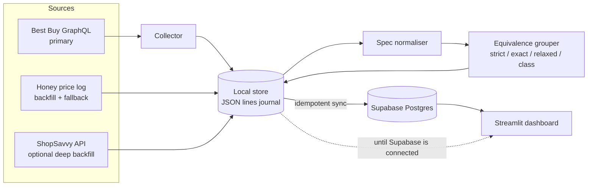

# PC Pricing Tracker

Tracks Best Buy prices for laptops with equivalent specifications, stores a daily price history, and groups the laptops so the trend can be compared across brands.

Built for the Lenovo AI Application Development Intern assignment ("AI-powered PC Pricing Tracker").

| | |
|---|---|
| Language | Python 3.11+ |
| Primary data source | Best Buy's own storefront GraphQL gateway (custom collector) |
| Backup data sources | PayPal Honey price log (backfill and fallback), ShopSavvy Data API (paid, optional; piloted, had no history for the laptops tested) |
| Baseline | An anchor brand (Lenovo by default). Its Best Buy laptops define the spec groups; other brands are matched to them |
| Matching | Rule-based, deterministic, four levels: strict, exact, relaxed, CPU class. No LLM at runtime |
| Price separation | Every price is stored by collection method; a third-party price is never written into a first-hand row |
| Storage | Local journal (JSON lines) mirrored to PostgreSQL on Supabase |
| UI | Streamlit dashboard with Plotly charts ([section 8](#8-dashboard)) |
| AI use | Development only, see [Use of AI tools](#11-use-of-ai-tools) |

**State on 19 Nov 2026:** 503 New, Best Buy-sold laptops from 10 makers collected with their full spec tables; 496 normalised into groups; 174 laptops in 98 tracked groups, priced first-hand on 19 Nov and backfilled to 24 Apr 2026 from Honey; everything is mirrored in Supabase (20 Nov), and the dashboard reads it from there. Scheduling the daily run is the main open item ([section 13](#13-open-items)).

---

## Contents

1. [What the assignment asks for](#1-what-the-assignment-asks-for)
2. [Architecture](#2-architecture)
3. [Data sources](#3-data-sources)
4. [Equivalence methodology](#4-equivalence-methodology)
5. [Storage and schema](#5-storage-and-schema)
6. [Update logic](#6-update-logic)
7. [Historical prices](#7-historical-prices)
8. [Dashboard](#8-dashboard)
9. [Setup and running](#9-setup-and-running)
10. [Assumptions and limitations](#10-assumptions-and-limitations)
11. [Use of AI tools](#11-use-of-ai-tools)
12. [Validation evidence](#12-validation-evidence)
13. [Open items](#13-open-items)

---

## 1. What the assignment asks for

| Deliverable | Where it is covered |
|---|---|
| Working tracker that captures current and historical prices | Sections 3, 6, 7 |
| Dynamic chart showing pricing trends over time | Section 8 |
| Clear methodology for identifying and grouping equivalent products | Section 4 |
| Documentation of data source, update logic, assumptions, limitations | Sections 3, 6, 10 |
| Explanation or demonstration of how the solution works | Sections 2, 9 |
| Explanation of how AI was used and where human validation was required | Section 11 |

Two points were clarified with Lenovo by email (16 Nov 2026):

- **History:** building the price history from daily snapshots collected from now until the interview is acceptable. This project does that, and additionally backfills earlier months from a third-party source (section 7).
- **Scope:** the three laptops in the brief are an example. The tracker must support any products with equivalent specifications, so groups are computed from specs and not hard-coded.

Example comparison set from the brief:

| Brand | Model | Screen | CPU | Memory | Storage | GPU | OS | Form |
|---|---|---|---|---|---|---|---|---|
| HP | OmniBook X Flip | 14" touch, 1920×1200 | Core Ultra 5 226V | 16 GB | 512 GB SSD | Intel Arc 130V | Windows | Convertible |
| Lenovo | Yoga | 16" touch, 1920×1200 | Core Ultra 5 226V | 16 GB | 512 GB SSD | Intel Arc 130V | Windows | Convertible |
| Dell | Plus | 16" touch, 1920×1200 | Core Ultra 5 226V | 16 GB | 512 GB SSD | Intel Arc 130V | Windows | Convertible |

How this example looks on Best Buy today is in [section 4.8](#48-results-on-19-nov-2026).

---

## 2. Architecture



Pipeline stages:

1. **Discover** laptops brand by brand from Best Buy's laptop category (New, sold by Best Buy).
2. **Collect** each SKU's full specification table, seller, UPC and current price.
3. **Normalise** the raw spec strings into a fixed set of typed fields.
4. **Group** products whose normalised specs are identical, at four match levels.
5. **Select** the groups worth tracking: those containing the anchor brand and at least one other brand.
6. **Store** one price row per tracked SKU, per day and per source, append-only.
7. **Backfill** earlier history from the backup source, labelled by source.
8. **Mirror** everything to Supabase for the dashboard.

### 2.1 Baseline and collection strategy

The tracker is driven by a **brands table** that is maintained by hand (`data/brands.json`, mirrored to `brands`) and a **specs table** (`spec_groups`) that is generated.

- **The anchor brand defines the baseline.** Each distinct normalised spec among the anchor brand's laptops is a candidate group. The anchor is Lenovo by default and is set with `ANCHOR_BRAND`, so the same tracker works from any brand's point of view.
- **Other brands supply the candidates.** Every other brand in the brands table is crawled the same way. A competitor laptop is tracked when its specs match an anchor-brand laptop.
- **Discovery is by brand, never by spec.** Searching Best Buy for a spec string returns near-misses (`226V` next to `228V`). Crawling a brand's category and matching afterwards keeps the matching exact and in one place.
- **The specs table is an output, not an input.** Most brand and spec combinations do not exist, and a typed list would contradict the requirement that groups are computed from specs.
- **Anchor specs with no competitor are reported, not hidden** (`python build_groups.py --show unmatched`).
- **Extending is one row or one URL.** A new brand is a row in the brands table; a single laptop is added by URL or SKU. Both go through the same normalise-and-group step.

Brands table at submission: Lenovo, HP, Dell, ASUS, Acer, Microsoft, Samsung, MSI, LG, GIGABYTE, plus Best Buy's separate sub-brand entries Alienware (counted as Dell) and HP OMEN (counted as HP). No limit was used: every New, Best Buy-sold laptop of each brand is collected, because the laptop that matches an anchor spec is not necessarily a best-seller. `--limit N` exists and takes the first N in Best Buy's best-selling order.

### 2.2 Scripts

| Script | What it does | When it runs |
|---|---|---|
| `collect_top_laptops.py --brand <name>` / `--all-brands` | Crawls a brand's laptops and saves each product with its raw spec table and the price seen | Once per brand, then occasionally to pick up new listings |
| `add_to_collection.py <url-or-sku> ...` | Adds single laptops through the same save path and pins them: always priced, their exact group always featured | On demand |
| `build_groups.py` | Normalises specs, computes the three group keys, marks tracked and featured groups, prints the summary | After any collect or add (add runs it itself) |
| `get_prices_now.py` | Fetches today's price for every tracked SKU (`--all`: every collected laptop), falls back to Honey for failures, logs the run | Daily |
| `backfill_history.py` | Loads the Honey price log (default) or ShopSavvy history for the tracked SKUs (`--all`: every collected laptop) | Once, and again for newly tracked SKUs |
| `python -m tracker.db check\|init\|sync\|pull` | Supabase: test the connection, create the schema, push the local store, rebuild a local store | Setup, and whenever a sync was skipped |
| `streamlit run app/streamlit_app.py` | The dashboard (section 8) | Whenever the charts are wanted |

### 2.3 Repository layout

```
laptop-price-chart/
├── collect_top_laptops.py         # crawl brands into the collection
├── add_to_collection.py           # add laptops by URL or SKU (pinned)
├── build_groups.py                # normalise, group, mark tracked + featured groups
├── get_prices_now.py              # daily price run
├── backfill_history.py            # third-party history for tracked SKUs
├── tracker/
│   ├── sources/
│   │   ├── bestbuy_graphql.py     # primary collector (session, listing, specs, prices)
│   │   ├── honey.py               # backfill and fallback
│   │   └── shopsavvy.py           # optional paid backfill (older history)
│   ├── normalise.py               # raw specs + title -> typed fields, keys, labels
│   ├── grouping.py                # the four match levels, tracked and featured groups
│   ├── collect.py                 # steps shared by the scripts
│   ├── store.py                   # local JSON-lines store (journal)
│   ├── db.py                      # Supabase/Postgres mirror
│   ├── dashboard.py               # data layer of the dashboard (no Streamlit: testable)
│   └── config.py                  # settings from .env
├── app/
│   ├── streamlit_app.py           # dashboard entry point: navigation between the pages
│   ├── app_pages/groups.py        # comparison groups page
│   ├── app_pages/explorer.py      # spec explorer page: filters for every spec
│   ├── app_pages/data.py          # data and methods page: methods, unmatched specs, review queue, runs
│   ├── common.py                  # shared: data loading, the price-trend section
│   └── charts.py                  # Plotly figures, brand colours
├── sql/schema.sql                 # tables, views, read-only policies
├── tests/                         # pytest: normaliser table, grouping, store, sources, dashboard, database
├── data/                          # the local store (not committed)
├── bestbuy-scalper/               # first test scraper, kept for reference
├── bestbuy-price-history/         # research scripts: Honey, Klarna, Common Crawl
├── .env.example
├── requirements.txt
└── README.md
```

---

## 3. Data sources

### 3.1 Primary: Best Buy storefront GraphQL

The collector calls the same GraphQL gateway the bestbuy.com pages use (`https://www.bestbuy.com/gateway/graphql`). It is the authoritative source for the current price and for specifications.

Why this source and not the official Best Buy Developer API: an access request was submitted and no key had been issued within the assignment window. The official API also has no historical price endpoint, so it would not have removed the need for daily snapshots.

Three operations are used:

| Operation | Query | Used for |
|---|---|---|
| `PlpSearch` | `search(...)` on the "All Laptops" category with facet filters `brand_facet`, `condition_facet = New`, Marketplace off | Discovery: 15 products per page, best-selling order |
| `ProductDetails` | aliased `productBySkuId`, 10 SKUs per request | `specificationGroups { name specifications { displayName value } }`, `seller { classification }`, `bsin`, `upc`, category |
| `PriceBatch` | aliased `productBySkuId`, 20 SKUs per request | `price { customerPrice regularPrice }` for the daily run |

What a Best Buy product exposes:

| Concept | Meaning | Why it matters |
|---|---|---|
| **SKU** | Numeric ID for one offer of a product, e.g. `6615769` | Primary key for price tracking |
| **BSIN** | Product ID in new-style URLs (`/product/<slug>/<BSIN>`) | One BSIN groups several SKUs |
| **UPC** | Barcode | The identifier ShopSavvy matches on |
| **Seller classification** | `1P` (sold by Best Buy) or `3P` (Marketplace seller) | Only 1P is the Best Buy price |
| `customerPrice` | The price the shopper pays now | Stored as `price` |
| `regularPrice` | Best Buy's list or "Comp. Value" price | Stored as `list_price` |
| Specification table | About 150 rows in 17 groups (Processor, Memory, Storage, Graphics, Display, Features, ...) | Input of the normaliser, stored untouched |

Rules the collector applies:

- **Collect New offers sold by Best Buy.** The listing is filtered with `condition_facet = New` and Marketplace disabled, and the seller class of every SKU is stored. Of 1,947 Lenovo listings on the site, about 130 are Best Buy's own New offers; the rest are Marketplace, mostly reconfigured ("Upgraded ... + Dock Set") machines. Marketplace and open-box prices are different offers, not the Best Buy price. `--include-marketplace` and `--condition` exist for inspection; such offers are never counted in a group.
- **Package bundles are skipped.** The listing mixes in bundle entries with no single product behind them, which is why a brand can return fewer SKUs than the listing's `numFound`.
- **Fixed, low request rate.** One request per `REQUEST_DELAY_SECONDS` (default 1 s), at most two in flight, retries with backoff on transient errors. The whole collection (12 brand entries, 503 laptops with spec tables) took 55 requests; the daily run takes 9 (20 laptops per request).
- **Stop on refusal.** The gateway only answers a session whose cookies were earned by a real browser, so the first run opens Chrome once (Playwright), waits until the gateway answers from inside the page and hands the cookies to plain HTTP requests (curl_cffi). The accepted session is cached in `.bestbuy_session.json`. A rejected cached session is replaced by one browser warm-up; any other refusal ends the run. Nothing escalates.
- **Record every run** in `scrape_runs`, including failures, so gaps in the series are explainable.

In-stock status is not collected: `in_stock` is stored as unknown for first-hand rows.

### 3.2 Backup A: PayPal Honey price log

Honey keeps a dated price-change log per Best Buy SKU and serves it from a public endpoint with no key or login. It is used for two things: backfilling history from before this tracker existed, and filling a day when the primary collector fails.

The Honey product ID is derived from the Best Buy SKU, so no search or fuzzy match is needed:

```
honey_product_id = "28_" + md5(md5(sku)) + "_" + md5(md5(sku))        # 28 = Best Buy US
```

```
GET https://d.joinhoney.com/v3
    ?operationName=web_getProductPriceHistory
    &variables={"productId":"<id>","timeframe":400}
```

| Operation | Variables | Returns |
|---|---|---|
| `web_getProductPriceHistory` | `productId`, `timeframe` (days) | `history[]` of `{day, lo, hi}` in cents, plus `prevPoint` |
| `web_getProductByIds` | `productIds[]` | title, canonical Best Buy URL, `priceCurrent`, `priceList`, `updated` |

Properties to know:

- **It is a change log, not a daily sample.** A point is written when the price changes; the price holds until the next point. The tracker expands it to one row per day: change points are stored as `honey`, the days between as `honey_carried`, and nothing is written after the date Honey last checked the product.
- **Coverage is 1P SKUs only.** Marketplace SKUs are absent.
- **Records start on 24 April 2026** for most products.
- **It is unofficial and undocumented.** It can change without notice, which is why it is a backup and not the primary source.

### 3.3 Backup B: ShopSavvy Data API (optional, paid)

ShopSavvy is the only source here with a published, documented API for retailer price history. It is the route to history older than Honey's 24 April 2026 start, and the fallback if Honey's unofficial endpoint stops working.

**Status: the client works; the data is not there.** `tracker/sources/shopsavvy.py` was written against ShopSavvy's OpenAPI specification (`https://api.shopsavvy.com/v1/openapi.json`, v1.3.1) and its documentation, and is covered by unit tests. A pilot on 20 Nov 2026 asked for 10 tracked laptops that were already on sale before Honey's log starts, over 25 Mar to 24 May 2026 (one request, 71 credits):

| Pilot result | Laptops |
|---|---|
| UPC unknown to ShopSavvy | 4 of 10 (both laptops of the brief's example among them) |
| UPC matched to a different product (a Dell desktop), no Best Buy offer | 1 |
| Matched, Best Buy-sold New offer found, **history empty for the window** | 5 |
| Price points returned | 0 |

The request, the matching by UPC, the first-party filter and the credit accounting all behaved as documented (5 products with offers × 2 + 61 days = 71). But every Best Buy offer ShopSavvy holds for these laptops was last seen between September and November 2026, and none has a point in spring 2026: ShopSavvy appears to have started following these listings only recently, a period Honey already covers. **No further credits were spent**, and ShopSavvy is not used for the history in this project. Every paid answer is kept in `data/shopsavvy_raw/`.

```
GET https://api.shopsavvy.com/v1/products/offers/history
    ?ids=<upc1>,<upc2>,...&start=YYYY-MM-DD&end=YYYY-MM-DD&retailer=bestbuy.com
Authorization: Bearer $SHOPSAVVY_API_KEY
```

| Property | Detail (per ShopSavvy's OpenAPI spec and docs) |
|---|---|
| Product identifiers | One `ids` parameter for every type: UPC/EAN, model number or MPN, ASIN, product URL. The tracker sends each laptop's UPC, which is matched exactly as a barcode |
| Mapping results | By each product's `match.identifier`, never by position: identifiers that match nothing are simply absent |
| Retailer filter | `retailer` is a bare domain, `bestbuy.com`. The response names it "Best Buy" |
| Window | At most 366 days per request; longer ranges are split into successive requests |
| Batch size | Up to 100 identifiers per request |
| Response | `data[]` (products) → `offers[]` (one per listing) → `history[]` (points, newest first: `timestamp`, `price`, `currency`, optional `availability`) |
| Filtering | Points are quality-filtered to match ShopSavvy's own chart, so sparse products return few points |

Cost model, which drives how the client is written:

| Call | Credits |
|---|---|
| History, per product with offers | 2 with `retailer` set (3 across all retailers) |
| History, per day of window | 1, charged **once per request**, not per product |
| Usage check (`/usage`) | 0 |
| Request that returns no offers, or any error | 0 |

Consequences, all enforced by the client:

- **Always batch.** 100 laptops over 90 days in one request costs `100 × 2 + 90 = 290` credits. The same data as 100 separate requests costs `100 × 92 = 9,200`.
- **Look up by UPC, never by keyword search.**
- **Dry run by default.** `backfill_history.py --source shopsavvy` prints the worst-case cost and the credits remaining, and requests nothing without `--yes`.
- **Only Best Buy-sold New offers are stored:** `condition == "new"`, `is_marketplace` not true, no `seller`, and the offer URL must carry the tracked SKU (or ShopSavvy's own `identifiers.bestbuy` must equal it). A Marketplace offer on bestbuy.com is skipped.
- Rows are stored as `shopsavvy` (observed point) and `shopsavvy_carried` (days between observations). They rank below Honey until validated the same way Honey was (section 12).

Only 72 of the 174 tracked laptops were on sale before 24 April 2026, so only those could have earlier history at all; a deep backfill for them (19 Nov 2025 to 23 Apr 2026) would cost at most 300 credits. The pilot above gives no reason to spend them.

### 3.4 Research sources, not part of the tracker

`bestbuy-price-history/` holds the scripts used to choose and validate the backup source:

- **Klarna price comparison** returns one price per day for about three months without login. It was rejected as a source because Klarna's product-to-SKU matching is approximate and its "Best Buy" series mixes Best Buy's own price with Marketplace sellers.
- **Common Crawl** stores the real bestbuy.com product page HTML, zero to a few captures per product per month, each carrying the price in its JSON-LD block. It is too sparse to be a price series, but it is Best Buy's own page, so it served as the ground truth for validating Honey (section 12).

### 3.5 Source priority

When more than one source has a price for the same SKU and day, the merged series takes them in this order:

1. `bestbuy_graphql` (collected by this tracker)
2. `honey` (observed change point)
3. `honey_carried` (Honey price carried forward from an earlier change point)
4. `shopsavvy`, then `shopsavvy_carried` (only where no Honey row exists, until validated)

All source rows are kept, one row per SKU, day and source. Two views sit on top (section 5):

- `prices_own` holds only what this tracker's collector observed.
- `daily_prices` applies the priority above to give one merged series, with the origin of every point still visible.

---

## 4. Equivalence methodology

### 4.1 Principle

Two laptops are equivalent when their **normalised key specifications are identical**. The brief names the key specifications: CPU, memory, storage, chassis, operating system and form factor. Grouping is a deterministic function of those fields, so the same input always produces the same groups and every grouping decision can be explained by pointing at the fields.

The hard part is not the comparison, it is the normalisation: Best Buy's listings describe the same specification in many different ways, and some of what they say is wrong. The normaliser (`tracker/normalise.py`) was written against the real spec tables of all 503 collected laptops, and the rules below each answer something found in that data.

No LLM is used at runtime. Spec matching has a correct answer, and a rule-based matcher is reproducible, testable and free to run daily.

### 4.2 Normalised fields

The spec table is the primary source. The title is the fallback, and a cross-check. Where the two name different CPUs or different graphics cards, the listing contradicts itself on a key field and is held for review instead of being grouped on either reading. Where they disagree on memory or storage, the spec table is used and the disagreement is recorded on the product.

| Field | Raw examples (real) | Normalised | In exact key |
|---|---|---|---|
| `cpu_model` | `226V` · `Ultra 7 355` · `U7 355` · `IntelCore 7 350` · `AI 5 430` · `HX 370` · `X126100` | `intel-226v`, `intel-355`, `amd-430`, `qualcomm-x1-26-100` | Yes |
| `memory_gb` | "16 gigabytes" | `16` | Yes |
| `storage_gb` | "512 gigabytes", "1000 gigabytes", "1024 gigabytes" | `512`, `1024` | Yes |
| `storage_type` | "SSD", "SSD, SSD", "UFS", "eMMC" | `ssd` \| `ufs` \| `emmc` \| `hdd` \| `hybrid` | Yes |
| `form_factor` | "2-in-1 Design: true", title "2-in-1", "x360", "Flip", "Spin", "Surface Pro", "Zenbook Duo", product weight | `clamshell` \| `convertible` \| `detachable` \| `dual-screen` | Yes |
| `touchscreen` | "Touch Screen: true", title "Touchscreen", "Touch - Screen" | `true` \| `false` | Yes |
| `os` | "Windows 11 Home", "Windows 11 Home in S Mode", "Chrome OS", "Googlebook OS" | `windows` \| `chromeos` \| `googlebook` \| `macos` \| ... | Yes |
| `gpu` | "Intel Arc", "Intel Arc 130V", "NVIDIA GeForce RTX 5070 Ti" | `integrated`, `nvidia-rtx-5070-ti` | Yes |
| `cpu_name`, `cpu_class` | derived | "Intel Core Ultra 5 226V", `intel-core-ultra-5-s2` | Class level only |
| `screen_size_in`, `resolution` | "16 inches", "1920 x 1200 (WUXGA)" | `16.0`, `1920x1200` | No, reported and filterable |
| `brand`, `model_family`, `model_number`, `color`, `os_edition`, `gpu_name` | | text | No |

### 4.3 Design decisions, and the data behind them

- **The CPU is identified by vendor and model number, nothing else.** Best Buy's "Processor Model" field (the series) cannot be trusted: a Ryzen AI 7 350 is filed under "AMD Ryzen 7 3000 Series", a Core Ultra 7 355 under "Series 1", the Core 7 350 under "Intel Processor 300", and the N355 under five different series names. The model number is right in all but four listings and is unique within a vendor, so `intel-355` is the identity. Series and title only supply the display name. This is also what keeps near-misses apart: `226V`, `228V` and `225U` are three identities.
- **The model-number field is free text and is parsed, not compared.** The same Core Ultra 7 355 appears as `355`, `Ultra 7 355`, `U7 355` and `Processor 355`; the same Snapdragon as `X1-26-100`, `X1 26 100` and `X126100`. Each vendor has its own patterns; years, memory sizes and product codes in titles are excluded explicitly.
- **AMD PRO variants share the identity of the plain chip.** "PRO" appears in the title of some listings of a chip and not others, and the silicon is the same, so treating it as a different CPU would split groups on missing words. It is kept in the display name.
- **Integrated graphics are one value.** The Arc graphics of a Core Ultra 5 226V is listed as "Intel Arc", "Intel Arc 130V" and "Intel Graphics" by different brands, and some Dell listings label it "Dedicated". Integrated graphics are determined by the CPU, so the key holds `integrated` unless a discrete GPU model is present (in the spec table or the title), and then the model: `nvidia-rtx-5060`.
- **Storage is snapped to one size per drive.** 1 TB is "1000 gigabytes" on 123 listings and "1024 gigabytes" on 20. Both become `1024`.
- **Screen size is not in the key.** The brief's own example groups a 14" HP with 16" Lenovo and Dell models. It is kept as a field for filtering.
- **"Chassis" is interpreted as the physical build: form factor plus touchscreen.** The brief lists chassis and form factor separately without defining either. To be confirmed with Lenovo.
- **"Yoga" is not a 2-in-1 signal.** Yoga Slim and Yoga Pro are clamshells. Form factor comes from the "2-in-1 Design" flag (missing on 157 listings) and from explicit title words.
- **OS edition and colour are ignored.** Windows 11 Home and Pro both normalise to `windows`; colour variants fall in the same group.
- **One model number can be two CPUs.** The NVIDIA N1X is sold with 18 and with 20 cores under the same model number, $400 apart for otherwise identical Surface laptops. The core count ("Number of CPU Cores" row, or the title) is therefore part of that CPU's identity: `nvidia-n1x-18c` and `nvidia-n1x-20c`, one class.
- **Two-screen laptops are their own form factor.** A Zenbook Duo or Yoga Book 9i is neither a clamshell nor an ordinary 2-in-1; `dual-screen` keeps them out of both.
- **A 2-in-1 under two pounds is a detachable.** No laptop of 10 inches or more with its keyboard attached weighs that little: the lightest convertible collected is 2.51 lb, the detachables are 1.41 to 1.74 lb. The rule catches a detachable Chromebook whose listing only says "2-in-1".
- **Unparsed means unparsed.** A key field that cannot be read is stored as `NULL` and the product is flagged `needs_review`; it is never grouped on a guess. Wrong groups are worse than missing ones. Seven of 503 products are in this state: four with no CPU model number anywhere in the listing, two whose CPU field holds Microsoft's part number instead of a CPU, and one whose spec table and title name different graphics cards (`python build_groups.py --show review`).

### 4.4 Four match levels

Exact matching is the baseline and gives small groups. One narrower level (strict) and two wider ones are computed alongside it; each level contains the one before, and every group is labelled with its level.

| Level | Two laptops match when they have the same... | Ignores |
|---|---|---|
| **strict** | everything in exact, plus the screen size bucket | resolution, colour, OS edition |
| **exact** | CPU model, memory, storage size, storage type, form factor, touchscreen, OS, GPU | also the screen size |
| **relaxed** | CPU model, memory, storage size, form factor, OS, GPU | also storage type and touchscreen |
| **class** | CPU class, memory, storage size, form factor, OS, GPU | also the exact CPU model |

The **CPU class** is family + tier + generation: `intel-core-ultra-7-s2` covers the Core Ultra 7 255U, 255H, 256V, 258V and so on. It is the notion Best Buy's "Processor Model" field is meant to hold, derived from the model number instead (first digit is the generation; the tier comes from the name). Naming schemes with no generations (N150, Celeron, Kompanio) keep the model as their class. Where a listing does not state the tier, the class of that model number is taken from the other listings of the same model (majority), so every listing of one CPU has one class and one display name.

The class level compares laptops of the same market tier, not of identical performance: a 255U and a 255H differ. It exists because at Best Buy no identical configuration is sold by more than three other brands, and it is always shown as "class", with each laptop's own CPU model next to it.

The **screen size bucket** of the strict level is one of `≤13`, `14`, `15–16`, `17+`. A size counts by its whole inches, as the size classes are sold: 13.3" and 13.8" are `≤13`, 14.5" is `14`, 15.6" and 16" share `15–16`. A laptop with no screen size on file has no strict group; it is still grouped from exact upwards (none of today's 496 grouped laptops is in that state).

```python
STRICT_FIELDS  = KEY_FIELDS + (screen_bucket,)
KEY_FIELDS     = (cpu_model, memory_gb, storage_gb, storage_type, form_factor, touchscreen, os, gpu)
RELAXED_FIELDS = (cpu_model, memory_gb, storage_gb, form_factor, os, gpu)
CLASS_FIELDS   = (cpu_class, memory_gb, storage_gb, form_factor, os, gpu)
group_key      = sha1("|".join(map(str, values))).hexdigest()[:12]    # every key but the exact one is salted with its level
```

The label is generated from the fields, for example `Core Ultra 5 226V · 16 GB · 512 GB SSD · Convertible touch · Windows` (exact), the same with `· 15–16" ·` before the OS (strict), or `Core Ultra 7 Series 2 · 16 GB · 512 GB · Clamshell · Windows` (class).

The table under the chart follows the level: it shows a spec column only for what the group's level ignores, since only there can its laptops differ. A strict group shows none, an exact group the screen size, a relaxed group also storage type and a touchscreen checkbox, a class group also the CPU. The resolution, which no level compares, is always shown (`dashboard.differing_features`).

### 4.5 Tracked and featured groups

Only New offers sold by Best Buy count towards a group.

- A group is **tracked** when it contains the anchor brand and at least `MIN_COMPETITORS` other brands (default 1). Every laptop in a tracked group, at any level, gets a daily price. Sub-brands count as their maker (HP OMEN is HP, Alienware is Dell).
- The **featured** groups are the headline comparisons: `FEATURED_COUNT` groups (default 10), each with at least `FEATURED_MIN_COMPETITORS` other brands (default 2). They are chosen deterministically:
  1. The exact group of every pinned laptop comes first.
  2. Then one group per class-level family, families ordered by number of competitor brands. Each family is shown at the **narrowest of class, relaxed and exact that still contains all of its competitor brands**: widening is used only where it adds a brand. The strict level is never featured; it is chosen in the sidebar.
  3. Featured groups never share a laptop.

### 4.6 Supporting new products

Nothing is hard-coded to the three example laptops or to Lenovo. Adding a product means collecting it, by brand (`collect_top_laptops.py`) or by URL (`add_to_collection.py`); the normaliser and grouper place it automatically. A new product with the same key joins the existing group, and a new configuration creates a new group. The raw spec table of every product is stored, so a change to the rules is applied to the whole collection by running `build_groups.py`, without scraping again; `normaliser_ver` records which rule set produced each row.

### 4.7 Tests

`tests/test_normalise.py` is a table of real Best Buy titles and spec strings with their expected normalised values: 39 CPU listings covering every spelling found, listings with no model number that must stay unparsed, title numbers that are not CPU models (years, memory sizes, product codes, a model line named "Ultra"), 23 graphics cases, storage, OS, form factor and touchscreen cases. `tests/test_grouping.py` checks the behaviour as a whole: the brief's three laptops form one tracked group although they differ in screen size and in how the graphics are named; near-misses (`228V`, 8 GB, 256 GB, clamshell, ChromeOS, discrete GPU) stay out; the levels nest; sub-brands fold; Marketplace and open-box offers do not count; featured groups are ranked, distinct and as strict as possible.

```bash
pytest
```

### 4.8 Results on 19 Nov 2026

503 New, Best Buy-sold laptops; anchor brand Lenovo (123 laptops).

| Level | Groups | With a Lenovo | + at least 1 other brand | + 2 | + 3 | + 4 | + 5 |
|---|---|---|---|---|---|---|---|
| strict | 402 | 111 | 18 | 3 | 0 | 0 | 0 |
| exact | 330 | 93 | 25 | 6 | 0 | 0 | 0 |
| relaxed | 286 | 86 | 35 | 12 | 3 | 0 | 0 |
| class | 238 | 80 | 38 | 18 | 9 | 3 | 1 |

116 groups are tracked (174 laptops; the strict level, added on 20 Nov 2026, adds 18 groups and no laptop, because every strict group lies inside an exact one). Read the table as the honest ceiling of this retailer: Best Buy sells no identical configuration from more than three brands, so comparisons with five or six competitors only exist at the class level.

Featured groups:

| # | Level | Group | Competitors |
|---|---|---|---|
| 1 | exact | Core Ultra 5 226V · 16 GB · 512 GB SSD · Convertible touch · Windows | HP (pinned: the brief's example) |
| 2 | class | Core Ultra 7 Series 2 · 16 GB · 512 GB · Clamshell · Windows | Acer, Dell, HP, LG, Samsung |
| 3 | class | Core Ultra 5 Series 3 · 16 GB · 512 GB · Clamshell · Windows | Acer, Dell, HP, Samsung |
| 4 | class | Core Ultra 7 Series 2 · 32 GB · 1 TB · Clamshell · Windows | ASUS, Acer, Dell, Samsung |
| 5 | relaxed | Snapdragon X X1-26-100 · 8 GB · 256 GB · Clamshell · Windows | ASUS, HP, Samsung |
| 6 | class | Core 5 Series 3 · 8 GB · 256 GB · Clamshell · Windows | Dell, HP, LG |
| 7 | relaxed | Core Ultra 7 355 · 32 GB · 1 TB · Clamshell · Windows | ASUS, Acer, LG |
| 8 | class | AMD Ryzen AI 7 400 Series · 16 GB · 512 GB · Clamshell · Windows | Acer, Dell, HP |
| 9 | relaxed | Snapdragon X X1-26-100 · 16 GB · 256 GB · Clamshell · Windows | ASUS, HP, Samsung |
| 10 | class | AMD Ryzen 7 7000 Series · 16 GB · 512 GB · Clamshell · Windows | Acer, Dell, HP |

**The brief's example today.** The Lenovo Yoga 7i 2-in-1 16" (SKU 6615769, $649.99) and the HP OmniBook X Flip 14" (SKU 6613868, $999.99) form one exact group, although the Lenovo's title does not name the CPU model at all ("Intel Core Ultra 5 Processor 2024"; the `226V` is only in the spec table). Both are pinned, so the group is always featured. **The Dell is not there: Best Buy no longer lists a Dell Plus 2-in-1 with the Core Ultra 5 226V**, as a New, open-box, refurbished or Marketplace offer. Dell's Plus 14" and 16" 2-in-1 are sold with the Core Ultra 7 256V, and they group with Lenovo's Yoga 7i 256V (`Core Ultra 7 256V · 16 GB · 512 GB SSD · Convertible touch · Windows`). That the three example laptops do group when all are present is covered by a test built from Dell's real listing format.

---

## 5. Storage and schema

**Local store first, Supabase as a mirror.** Every script writes to the local store (`data/`, JSON lines) and then syncs to Postgres. A day the collector ran is therefore never lost to a database outage, everything works before Supabase is connected, and the database can be rebuilt at any time: `python -m tracker.db sync` replays the local store, and all statements are idempotent. `python -m tracker.db pull` does the reverse on a new machine.

| Local file | Table | Content |
|---|---|---|
| `brands.json` | `brands` | The brands table, maintained by hand |
| `products.jsonl` | `products` | One collected SKU per row, with its untouched spec table (`raw_specs`) |
| `product_specs.jsonl` | `product_specs` | Normalised fields and the three group keys (generated) |
| `spec_groups.json` | `spec_groups` | The groups at all four levels (generated, rewritten in full) |
| `price_snapshots.jsonl` | `price_snapshots` | Append-only prices, unique on `(sku, snapshot_date, source)` |
| `scrape_runs.jsonl` | `scrape_runs` | Run log |

The full DDL is in [`sql/schema.sql`](sql/schema.sql). The central table:

```sql
create table price_snapshots (
    id              bigint generated always as identity primary key,
    sku             text not null references products(sku),
    snapshot_date   date not null,               -- UTC date of the observation
    price           numeric(10,2) not null,      -- what the customer pays
    list_price      numeric(10,2),
    in_stock        boolean,
    source          text not null,               -- bestbuy_graphql | honey | honey_carried | shopsavvy | shopsavvy_carried
    flagged         boolean not null default false, -- failed the sanity check: stored, not charted
    captured_at     timestamptz not null default now(),
    run_id          bigint,
    unique (sku, snapshot_date, source)
);
```

Views:

| View | Content |
|---|---|
| `prices_own` | First-hand prices only (`bestbuy_graphql`, not flagged) |
| `daily_prices` | One price per SKU per day by the source priority of section 3.5 |
| `group_members` | `(group_key, level, sku)` for every group at every level; only New, Best Buy-sold, active laptops |
| `tracked_skus` | Members of tracked groups plus pinned laptops: what the daily job prices |

Design points:

- `unique (sku, snapshot_date, source)` makes every job idempotent. Re-running a day inserts nothing new. It also keeps the collection methods apart: each method has its own row for the same SKU and day.
- `raw_specs` is kept so that a change to the normalisation rules can be re-applied to all products without re-scraping.
- Run IDs are made by the job (epoch milliseconds), so a run logged offline keeps its ID when it is replayed.
- **Access.** The tracker connects with the database password as `postgres`, which bypasses row level security. The schema enables RLS on every table, revokes everything from the Data API roles and grants `select` only, with a read-only policy; the views use `security_invoker`. The dashboard can therefore read with the publishable key and cannot write.

---

## 6. Update logic

One job, once per day:

```
get_prices_now.py
 1. load the tracked SKUs (members of tracked groups + pinned laptops)
 2. fetch prices from Best Buy in batches of 20 (retry with backoff, max 3)
      priced      -> price_snapshots row, source = bestbuy_graphql
      not priced  -> queued for fallback
 3. sanity check: a price below 30% or above 300% of the SKU's 30-day median is stored but flagged
 4. fallback: for queued SKUs, read Honey's log for the last 7 days (rows land on their true dates)
 5. append the run to scrape_runs with counts and status (ok | partial | failed)
 6. sync the new rows to Supabase
```

Discovery and grouping are not part of the daily run. `collect_top_laptops.py` and `build_groups.py` are run when the collection changes, so the daily job stays small: 9 requests for the tracked laptops, a few seconds.

| Aspect | Behaviour |
|---|---|
| Frequency | Once per day. Best Buy changes laptop prices at most a few times a week, so daily resolution captures the trend. |
| Idempotency | A second run on the same day adds nothing (verified: `0 new price rows`). |
| Partial failure | A failed SKU does not fail the run. The run is marked `partial` and the SKU falls back to Honey. |
| Blocked session | The run stops, is logged as `failed`, and Honey covers the day where it can. |
| Missing days | Never invented. A day with no source row is a gap in the series. |
| Delisted products | Marked `active = false` after three consecutive "no such SKU" answers; their history is kept. A blocked run never counts. |
| Database down | The run completes against the local store; the next sync catches up. |

**Scheduling is not set up.** The job is started by hand for now. Because the gateway needs cookies from a real, visible browser session, the job has to run on a machine with a desktop, which rules out a plain cloud cron; a scheduled task on the machine that holds the session is the natural fit.

---

## 7. Historical prices

Best Buy exposes no price history, officially or on the page. The history therefore comes from layers, each labelled in the data.

| Layer | Period | Source | Granularity | Trust |
|---|---|---|---|---|
| Own snapshots | From 19 Nov 2026 onward | Best Buy GraphQL | One observation per day | Highest: read from Best Buy on that day |
| Backfill | 24 Apr 2026 to the first own snapshot | Honey change log | Change points, expanded to daily by carry-forward | High: 95% exact agreement with Best Buy's archived pages (section 12) |
| Deep backfill (optional) | Before 24 Apr 2026, up to 366 days per request | ShopSavvy Data API | Dated points, filtered by ShopSavvy | Not used: the pilot returned no points (section 3.3) |

**The first-hand series is the tracker; the backfill is supporting data.** Lenovo accepted a history built from daily snapshots (section 1), so the own-snapshot layer alone meets the brief. The backfill adds earlier months and stays separable by source.

State of the store on 19 Nov 2026:

| Source | Rows | Laptops | From | To |
|---|---|---|---|---|
| `bestbuy_graphql` | 503 | 503 | 19 Nov 2026 | 19 Nov 2026 |
| `honey` | 2,105 | 179 | 24 Apr 2026 | 19 Nov 2026 |
| `honey_carried` | 24,628 | 179 | 25 Apr 2026 | 19 Nov 2026 |

Honey had a record for every one of the 179 laptops tracked when the backfill ran (median 171 days each); 174 of them are tracked under the current rules.

Backfill procedure (`python backfill_history.py`):

1. For each tracked SKU, compute the Honey ID and request the full history.
2. Store each change point as `source = 'honey'`.
3. For the days between change points, store the carried-forward price as `source = 'honey_carried'`, stopping at the date Honey last checked the product.
4. Never overwrite a `bestbuy_graphql` row; the view's priority handles overlap.

---

## 8. Dashboard

```bash
streamlit run app/streamlit_app.py
```

A Streamlit app (`app/streamlit_app.py`) with Plotly charts (`app/charts.py`). It reads Supabase when `SUPABASE_DB_URL` is configured and reachable, and the local store otherwise, so it works before the database is connected and each daily run appears without redeploying anything. All shaping of the data is in `tracker/dashboard.py`, which has no Streamlit in it and is covered by tests.

It has three pages, switched from the bar at the top:

- **Comparison groups** (`app/app_pages/groups.py`): the groups the tracker computed, Lenovo against the brands with matching specs. Described in the table below.
- **Spec explorer** (`app/app_pages/explorer.py`): every collected laptop, filtered by any combination of specs chosen in the sidebar, with the same headline figures, trend chart and table redrawn for whatever matches. Filters: brand, processor family, processor model, memory (range), storage (range), storage type, form factor, touchscreen, operating system, graphics, screen size (range) and current price (range). An empty list accepts everything; filters combine with "and". It answers questions the fixed groups do not, such as "all 16 GB convertibles with a Core Ultra 7 of any generation". The explorer covers the 496 laptops that normalised fully; price history for laptops outside the tracked groups comes from `python backfill_history.py --all`, and they get first-hand prices only when the daily job is run with `--all`.
- **Data and methods** (`app/app_pages/data.py`): everything that does not depend on a group, in four tabs. *Collection methods*: rows, laptops and date range per method, and for any one laptop, one line per method, never merged. *Unmatched Lenovo specs*: Lenovo configurations with no identical configuration from another brand. *Review queue*: laptops the normaliser could not place, with the reason. *Runs*: the run log.

The comparison groups page:

| Element | Behaviour |
|---|---|
| Group picker (sidebar) | The featured groups, each with its match level and competitor brands; or every tracked group at a chosen level (strict, exact, relaxed, class) |
| Header | The group's spec label, the brands compared, and what its match level does and does not guarantee |
| Filters (one row, above everything they scope) | Period (30, 90, 180 days, all), prices (own scraper only, or own scraper + backfill), brands |
| Headline figures | Lenovo's lowest price in the group and its change in 30 days; the cheapest competitor; the gap between the two; laptops and brands compared |
| Trend chart, by brand | One step line per brand: the lowest price among that brand's laptops in the group, labelled at its end with the brand and the current price. Hover shows every brand's price on that day, which laptop it was, and where the price came from |
| Trend chart, by laptop | One step line per laptop, coloured by brand; hover names the model |
| Table | Per laptop: the specs its match level ignores (see 4.4), price now, trend sparkline, discount from list price, lowest and highest in the period, when it was last at its lowest, days at the current price, link to Best Buy |
| Sidebar footer (every page) | The last price run and where the data is read from |

Chart conventions:

- **A solid line with dots is a price this tracker read from Best Buy itself; a dashed line is backfill** from Honey's price log. A hairline marks the first day of first-hand prices.
- **Lines are steps**, because a price holds until it changes. **A day nobody observed is a gap**, never an interpolated value.
- **Colour identifies the brand and follows the brand**: filtering does not repaint the brands that remain. Eight hues cannot all be told apart pairwise, so the colours were assigned to keep the closest hues on brands that rarely share a group, and the chart never relies on colour alone: every brand line is labelled at its end, listed in the legend and named in the hover.
- **Default price mode.** The dashboard defaults to the own scraper only, as designed. While the first-hand history is shorter than seven days it switches the backfill on by default and says so, because a chart of one or two dots shows no trend.

"Dynamic" in the brief is met in two ways: the charts are interactive, and they read the store live.

---

## 9. Setup and running

Requirements: Python 3.11+, Google Chrome (for the one-off session warm-up), a Supabase project.

```bash
python -m venv .venv
.venv\Scripts\activate            # Windows;  source .venv/bin/activate elsewhere
pip install -r requirements.txt
copy .env.example .env
```

Environment variables (`.env`, never committed):

| Variable | Purpose |
|---|---|
| `SUPABASE_DB_URL` | Postgres connection string. Unset: local store only |
| `ANCHOR_BRAND` | Brand whose laptops define the baseline spec groups. Default `Lenovo` |
| `REQUEST_DELAY_SECONDS` | Minimum pause between Best Buy requests. Default `1.0` |
| `MIN_COMPETITORS` | Other brands a group needs to be tracked. Default `1` |
| `FEATURED_COUNT`, `FEATURED_MIN_COMPETITORS` | Featured groups. Defaults `10` and `2` |
| `SHOPSAVVY_API_KEY` | Optional. Enables the ShopSavvy backfill; the tracker runs without it |

**Supabase connection.** Use the **Session pooler** string from the dashboard's Connect button:

```
postgresql://postgres.<project-ref>:<password>@aws-<n>-<region>.pooler.supabase.com:5432/postgres
```

The "Direct connection" string (`db.<project-ref>.supabase.co`) is IPv6-only on the free plan and does not resolve from an IPv4-only network. Then:

```bash
python -m tracker.db init         # tables, views, read-only policies
python -m tracker.db sync         # push everything collected so far
python -m tracker.db check
```

Build the collection, anchor brand first, then every other brand in the brands table:

```bash
python collect_top_laptops.py --all-brands
```

One brand only:

```bash
python collect_top_laptops.py --brand hp
```

Normalise, group and mark the tracked groups:

```bash
python build_groups.py
python build_groups.py --show featured
```

Add single laptops by URL or SKU (pinned):

```bash
python add_to_collection.py 6615769 "https://www.bestbuy.com/site/6613868.p?skuId=6613868"
```

Fetch today's prices (the daily command):

```bash
python get_prices_now.py
```

Backfill history from Honey:

```bash
python backfill_history.py
```

Optional deeper backfill from ShopSavvy (paid credits; without `--yes` it only prints the cost):

```bash
python backfill_history.py --source shopsavvy --start 2025-11-19 --end 2026-04-23 --limit 5
```

Open the dashboard (http://localhost:8501):

```bash
streamlit run app/streamlit_app.py
```

Run the tests:

```bash
pytest
```

The database test is skipped unless `TEST_DATABASE_URL` points at a disposable PostgreSQL server.

---

## 10. Assumptions and limitations

**Data source**

- The primary source is Best Buy's internal storefront gateway, not a published API. Best Buy can change its schema or restrict access at any time; the collector may break without warning. The backup source exists for that case.
- The gateway needs cookies from a real, visible browser session, so the collector cannot run headless or from a cloud runner.
- Honey's endpoint is also unofficial. Both sources are used at low volume for a recruitment assignment; a production system should use a licensed feed or the official Best Buy API once access is granted.
- ShopSavvy is a documented, paid API, but in a pilot it had no price history for any of the 10 laptops tested and did not know 4 of them. The conclusion rests on that one sample; history before 24 April 2026 therefore remains unavailable.
- Prices are the national online price. Store-specific pricing, member-only prices, coupons, trade-in credits, student discounts and bundle offers are not captured. Stock status is not captured.

**History**

- First-hand history starts on 19 Nov 2026. Everything earlier is backfill and is kept separate from it.
- Backfill starts on 24 April 2026 and covers only products sold by Best Buy itself.
- Backfill is a change log. A price that appeared and disappeared between two Honey checks is missed. In validation about 4% of checked days disagreed with Best Buy's archived page.
- The tracker samples once a day. Intraday changes (flash deals) are not seen.

**Matching**

- Equivalence means identical normalised key specs. It does not measure quality differences inside those specs: panel type and brightness, battery, build material, weight, keyboard and warranty are ignored. Two "equivalent" laptops are equivalent on paper, not necessarily in value. A business ThinkPad and a consumer IdeaPad with the same key specs are one group.
- The class level groups by processor family, tier and generation. Chips in one class can differ considerably (U, V and H variants); it is a market-tier comparison and is labelled as such.
- AMD PRO and non-PRO chips are treated as the same CPU.
- Screen size is deliberately outside the key, following the example set in the brief. "Chassis" is interpreted as form factor plus touchscreen.
- Matching depends on Best Buy's spec table being present and its model-number, memory, storage and flag rows being right. Where the spec table and the title disagree the spec table is used and the disagreement is noted on the product (`review_notes`). Products that cannot be parsed are held for review and do not appear in any group.
- Detachables are recognised by a short list of title words (Surface Pro, Detachable, Flow Z13, ProArt PZ, Duet, Tablet) or by a 2-in-1 weighing under two pounds; dual-screen laptops by title words (Dual Screen, Zenbook Duo, Yoga Book). A new line that uses neither needs a new word.
- 157 of the 503 listings have no "2-in-1 Design" row. Such a laptop is a convertible only if its title says so (2-in-1, x360, Flip, Spin, 360, Flex, ThinkPad Yoga); otherwise it is taken as a clamshell.
- The title fallback matters for listings without a spec table (Marketplace offers, which are not tracked). It returns nothing rather than a guess when a title lists two drives or an add-on ("512GB SSD + 1TB Dock").

**Scope**

- Best Buy US only, New condition, sold by Best Buy only.
- Only groups that contain the anchor brand are tracked. A comparison between two competitor brands with no Lenovo equivalent is not tracked unless the anchor is changed or the laptops are added by URL.
- Coverage is limited to the brands in the brands table. Apple is left out: no Lenovo laptop runs macOS, so no group could contain both.
- Laptops only. The normaliser's CPU and form-factor rules are laptop-specific.

---

## 11. Use of AI tools

AI was used to build the solution. No AI model runs inside the tracker.

| Task | AI tool | What it did | Human validation required |
|---|---|---|---|
| Researching sources of historical Best Buy prices | Claude (Claude Code) | Tested candidate sources with live requests, found Honey's endpoint and that its product ID is derived from the SKU, and found Klarna's and Common Crawl's data | Re-run the calls independently; confirm returned prices against known Best Buy prices; review whether each source is acceptable to use |
| Validating the backup source | Claude | Compared Honey's prices with ~590 archived Best Buy page captures | Review the method, the sample and the mismatches before relying on the 95% figure |
| Collector | Claude (Claude Code) | Extended the author's test scraper into the collector: listing by brand and condition, spec tables, seller class, pacing, session handling, resumable crawl | Review of request rate, error handling and secret handling before running against the live site; a sample of collected prices checked by hand against the product pages |
| Normalisation rules | Claude (Claude Code) | Profiled the spec tables of all 503 laptops, wrote the rules from the value distributions, and audited the result with independent reviewer agents | Every design decision in section 4.3; a read-through of the tracked groups (`build_groups.py --show tracked`) to confirm each is a sensible comparison; the review queue |
| Match levels and featured groups | Claude | Measured how many groups each level produces and proposed the class level when exact matching could not reach more than three competitor brands | Whether a class-level comparison is acceptable for the assignment, and which level to present |
| Tests | Claude | Wrote the test tables from real listings | Check that the expected values in the tables are right, not just that the tests pass |
| ShopSavvy client | Claude | Read ShopSavvy's OpenAPI spec, docs and SDK source with two independent research agents and a reconciler, and wrote the client from that | The decision to stop after the pilot (71 credits, no price points) rather than spend more |
| Database layer | Claude | Wrote the schema, the sync and the read-only policies; tested them against a local PostgreSQL engine | Whether the collected data may be publicly readable: the Data API roles can read every table (and cannot write) |
| Dashboard | Claude (Claude Code) | Wrote the Streamlit page, the Plotly charts and the data layer; checked the rendered pages from screenshots in light and dark themes; chose the brand colours by measuring every colour pair for colour-vision deficiency | Whether the default view answers the pricing question; a read of each featured group's chart against the table beneath it |
| Documentation | Claude | Drafted this README from the assignment brief, the project decisions and the measured results | Check every statement against the code and the data |
| Collection and presentation strategy | Claude | Reviewed the plan; advised generating the spec groups from collected products instead of a hand-written spec list | The choices to anchor on Lenovo and to separate prices by collection method were the author's |

Where human judgement is necessary and AI output should not be accepted as-is:

- **Deciding what "equivalent" means.** The interpretation of chassis, leaving screen size out of the key, merging PRO chips, collapsing integrated graphics, and offering a class level are design decisions, taken from the brief's example and from the data, and are the author's to defend.
- **Checking spec parsing.** Near-identical model numbers (`226V` vs `228V`) are different products and a loose pattern merges them. The rules are pinned by a test table of real listings.
- **Separating Best Buy's price from Marketplace prices.** An early comparison showed two sources disagreeing by over $100 on some days. Working out that one source reported third-party sellers needed inspection of the real page data, not a model's guess.
- **Trusting third-party data.** The backup source was accepted only after measuring it against Best Buy's own archived pages.
- **Running generated code against live services.** Request rate, stop conditions and credit spending were reviewed first.

Why no LLM at runtime: the grouping task is exact matching on a small set of fields. Rules are reproducible, testable, explainable to a reviewer and free to run daily. An LLM would add cost and nondeterminism to a problem that has a correct answer. A sensible future use is assisting the review queue: proposing normalised values for products the rules could not parse, for a human to confirm.

---

## 12. Validation evidence

**Backup source against ground truth.** Honey's prices were compared with archived copies of Best Buy's own product pages from Common Crawl (May to October 2026; Lenovo, HP, ASUS, Samsung, Sony, Apple, LG and Insignia products). Each archived page gives the SKU and the price on the capture date.

| Check, Best Buy-sold (1P) SKUs | Result |
|---|---|
| Observations compared | 589 |
| Found in Honey | 587 (99.7%) |
| Same price on the same day | 560 (95.1%) |
| Same price within one day | 5 (0.8%) |
| Different price | 22 (3.7%) |

| Check, Marketplace (3P) SKUs | Result |
|---|---|
| Observations | 545 |
| Found in Honey | 0 |

**Backup source against the collector.** On 19 Nov 2026 the latest Honey price equalled the price the collector read from Best Buy for 176 of the 179 tracked laptops. The three differences were price changes of that day or the day before which Honey had not recorded yet.

**Normaliser.** 496 of 503 collected laptops receive a complete key; the seven that do not are listed in section 4.3. Cross-check notes on grouped products: five where the spec table calls integrated graphics "Dedicated", one where the title says touchscreen and the spec table does not.

**Normaliser audit.** The rules were audited against all 503 listings by three independent reviewer agents (CPU; memory, storage and graphics; chassis, OS and descriptive fields), each instructed to prove defects from the listing's own raw data. Their findings were checked by hand against the data before anything was changed. Fixed as a result: the N1X 18/20-core split (19 laptops, two exact groups that mixed the two), dual-screen laptops grouped with ordinary ones (4 laptops, 3 tracked groups removed), a detachable classed as a convertible, two Microsoft part numbers read as CPU models, and a set of guards against silently wrong values on listing formats not in today's data (thousands separators, a year read as a model number, older Intel generations, a discrete Radeon written without "RX"). A before/after diff over all 503 laptops confirmed that only the intended fields changed. Two further reviews (the groups as a whole, and behaviour on title-only Marketplace listings) did not complete and are open.

**Daily job.** A second run on the same day priced 179 of 179 laptops (the tracked set at that time) in 9 requests and added no rows.

**Database layer.** The schema, the sync, the views and the pull were run against a local PostgreSQL engine with the full store (503 products, 850 groups, 27,236 price rows): a second sync inserted nothing, and the `tracked_skus` view returned exactly the 179 SKUs the daily job computes locally. 

**Supabase.** On 20 Nov 2026 the schema was applied to the Supabase project (PostgreSQL 17, through the session pooler) and the local store loaded: 503 products, 503 spec rows, 854 groups, 27,236 price rows, 6 runs. A second sync inserted nothing; the `tracked_skus` view returned exactly the 174 SKUs computed locally; the dashboard's loader read the same prices from Supabase as from the local store. Access was checked by switching to the `anon` role: it can read every table and view, and an insert is refused ("permission denied").

**Worked example.** Lenovo IdeaPad Slim 3 15.6", Ryzen 5, 8 GB / 256 GB, SKU `6668500`:

| Date | Best Buy archived page | Honey | Klarna |
|---|---|---|---|
| 10 Jun 2026 | $379.99 | $379.99 | outside its 3-month window |
| 20 Oct 2026 | no capture | $369.99 | $369.99 |
| 5 Nov 2026 | no capture | $349.99 | $349.99 |

---

## 13. Open items

| # | Item | Section |
|---|---|---|
| 1 | The tables are readable by anyone holding the project's publishable key (read-only by design, for the dashboard); tighten the policies if the data should stay private | 5 |
| 2 | Finish the normaliser audit: the reviews of the groups as a whole and of title-only listings did not complete | 12 |
| 3 | Decide how the daily job is scheduled; until then it is run by hand, and a day without a run is a day without a first-hand price | 6 |
| 4 | History before 24 Apr 2026 has no source: ShopSavvy's pilot returned nothing | 3.3, 7 |
| 5 | Which match level to present, and whether class-level groups are acceptable to Lenovo | 4.4, 4.8 |
| 6 | Interpretation of "chassis", ideally confirmed with Lenovo | 4.3 |
| 7 | Hand check of a sample of collected prices against the live product pages | 11, 12 |
| 8 | In-stock status is not collected | 3.1 |
