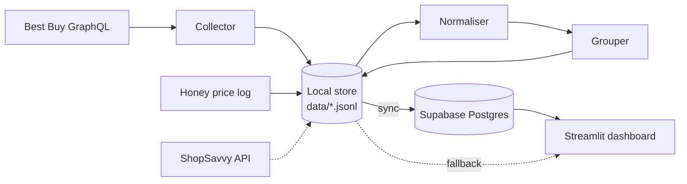

# Architecture

## The pipeline



| Step | What happens | Script | Module |
|---|---|---|---|
| 1. Discover | List a brand's New, Best Buy-sold laptops | `collect_top_laptops.py` | `sources/bestbuy_graphql.py` |
| 2. Collect | Fetch each SKU's spec table, seller, UPC and price | same | same, `collect.py` |
| 3. Normalise | Raw spec strings become typed fields | `build_groups.py` | `normalise.py` |
| 4. Group | Identical specs form groups at four levels; mark tracked and featured | same | `grouping.py` |
| 5. Price | One price row per tracked SKU per day | `get_prices_now.py` | `sources/bestbuy_graphql.py` |
| 6. Backfill | Earlier history from a third-party log | `backfill_history.py` | `sources/honey.py`, `sources/shopsavvy.py` |
| 7. Mirror | Push the local store to Supabase | every script, or `python -m tracker.db sync` | `db.py` |
| 8. Present | Charts and tables | `streamlit run app/streamlit_app.py` | `app/`, `dashboard.py` |

Steps 1 to 4 run when the collection changes. Step 5 runs daily. Step 6 runs once per laptop.

## Modules

```
tracker/
  config.py                 settings from .env; ROOT, DATA_DIR, db_configured()
  sources/
    bestbuy_graphql.py      session handling, the three GraphQL operations, Product
    honey.py                Honey change log -> daily rows
    shopsavvy.py            ShopSavvy history client, credit estimate, offer filter
  collect.py                glue used by the scripts: collect_brand, collect_skus,
                            snapshot_rows, flag_outliers, rebuild_groups, new_run_id
  normalise.py              normalise(product) -> Specs; keys; labels
  grouping.py               build(products) -> (specs, groups); tracked_skus; pick_featured
  store.py                  LocalStore over the files in data/
  db.py                     connect, init, sync, sync_safely, pull, check
  dashboard.py              loading and shaping for the dashboard; no Streamlit
app/
  streamlit_app.py          navigation
  common.py                 load_data, render_trend
  charts.py                 Plotly figures, brand colours
  app_pages/                groups.py, explorer.py, data.py
```

Dependencies point one way: the scripts call `collect`, `grouping`, `store` and `db`; `grouping` calls `normalise`; nothing in `tracker/` imports from `app/`. `normalise.py` has no dependencies inside the project and does no I/O.

## Principles

**Local store first, database second.** Every script writes the files in `data/` and then syncs to Postgres. A database outage never loses a day of prices, everything works before Supabase is connected, and the database can be rebuilt at any time. All database statements are idempotent, so a sync can be repeated freely. See [Storage](storage.md).

**Prices are append-only and separated by source.** A price row is identified by `(sku, snapshot_date, source)` and is never updated. A third-party price is never written into a first-hand row; the choice between sources is made when reading (the `daily_prices` view, or `dashboard.select_prices`).

**Raw data is kept.** The untouched spec table is stored with each product. Changing a normalisation rule means running `build_groups.py`, not scraping again.

**Deterministic matching.** `normalise(product)` depends only on the product's own title, brand and spec table. The same input always gives the same fields and keys, and every grouping decision can be explained by pointing at the fields. No model runs at runtime. The one step that looks across products is `grouping.harmonise_cpus`, which gives every listing of one CPU model the same class and display name by majority.

**Never guess.** A key field that cannot be read is left empty and the laptop is not grouped. A day nobody observed is a gap, not an interpolated price. A listing that contradicts itself on its CPU or GPU is held for review.

**Only Best Buy's own New offers count.** Marketplace and open-box offers are different prices for a different thing. They can be collected for inspection but never count towards a group and are never tracked.

**Be a polite client.** One request per second, at most two in flight, a stop on any refusal. The whole collection is 55 requests; the daily run is 9.

## Data model in one paragraph

A **product** is one Best Buy SKU with its raw spec table. Its **spec row** holds the normalised fields and four group keys, one per match level. A **group** is one distinct key at one level, with its members, brands and flags. A **price snapshot** is one price for one SKU on one day from one source. A **run** is one execution of a collecting job. Details in [Storage](storage.md).

## Where to make a change

| To... | Change |
|---|---|
| Track another brand | Add a row to `data/brands.json`, run `collect_top_laptops.py --brand <name>` |
| Track one specific laptop | `add_to_collection.py <url-or-sku>` |
| Fix how a spec is read | `tracker/normalise.py` and a row in `tests/test_normalise.py`; see [Normalisation](normalisation.md) |
| Change what "equivalent" means | The field tuples at the top of `normalise.py`; see [Grouping](grouping.md) |
| Change which groups are tracked or featured | `MIN_COMPETITORS`, `FEATURED_COUNT`, `FEATURED_MIN_COMPETITORS` in `.env` |
| Add a price source | A module in `tracker/sources/`, a source label, its rank in `daily_prices` and `dashboard.PRIORITY` |
| Add a dashboard page | A file in `app/app_pages/` and an `st.Page` in `app/streamlit_app.py`; see [Dashboard](dashboard.md) |
| Add a database column | `sql/schema.sql` (with an `alter table ... add column if not exists`), the column list in `db.py` |
